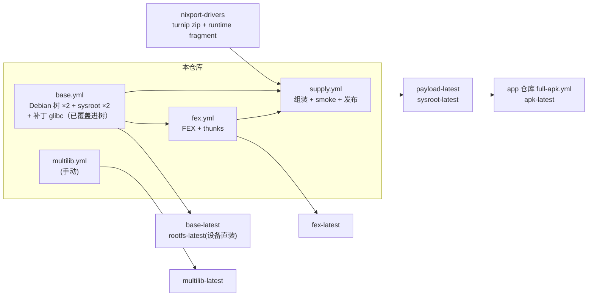

# nixport-rootfs

NixPort 的 **Runtime 组件供给仓库**：Debian 树（arm64 Runtime / x86_64 客机 / x86
multilib）、交叉编译 sysroot（arm64 / amd64）、补丁版 glibc / FEX-Emu、GPU 驱动
fragment，以及最终的**成品 payload 组装**。
app 仓库（fexdroid）的 release 构建与 Port 开发者的交叉编译都从这里消费滚动
release，**不在自己的仓库里编任何 Linux 侧组件**。

> 目录与树的语义（谁跑在哪、rootfs 和 sysroot 的区别）：
> app 仓库 `my-docs/运行环境/rootfs与sysroot-四棵树区分指南.md`。

## 流水线拓扑



三条主链严格按 DAG 顺序执行：**base → fex / supply**，supply 额外拉取 drivers
fragment。每条流水线发布独立的滚动 release，上游绿了下游才有意义。

## Release 渠道

| 渠道 | 发布者 | 内容 | 消费方 |
|---|---|---|---|
| `base-latest` | base.yml | 原料层：锁定树 `rootfs-arm64.tar.gz`（**已含补丁 glibc**）+ `packages.txt`（ABI 基线）+ `sysroot-arm64`（纯 Debian）+ `sysroot-x86_64` + x86_64 客机树 + `glibc.tar.gz`（DESTDIR） | fex.yml / supply.yml；Port 开发者 |
| `rootfs-latest` | base.yml | 设备直装包：`rootfs-arm64.tar.zst` + uris/base/packages 锁定清单 | 手机直装 / `nxp-rootfs-topup.sh` |
| `fex-latest` | fex.yml | `fex-install.tar.gz` + `contract.json`（fx_package / fxd_root / fxd_ldso / libc6 / fex_tag） | supply.yml 组装前校验契约 |
| `payload-latest` | supply.yml | **成品 payload**（组装 + qemu 自测完）：`payload-arm64/x86_64.tar.gz` + `payload.version/json` + `meta.json` | **app release**（`fetch-payload.sh`） |
| `sysroot-latest` | supply.yml | `sysroot-arm64.tar.gz`（republish 自 base） | **Port 开发者交叉编译** |
| `multilib-latest` | multilib.yml（手动） | 32 位 x86 客机树 | 手机端运行时下载（X86Rootfs.kt） |

契约文件：`meta.json`（schema `nixport.rootfs-meta.v1`：`fx_package` / `fxd_root` /
`fxd_ldso` / `libc6` 符号天花板 / 逐资产 sha256+size / `built_from` / `built_at`）、
fex 的 `contract.json`、逐资产 `.sha256` 供 `sha256sum -c`。

## ⭐ 改了什么代码 → 跑哪条流水线

**原则：改动落在哪一层，就从那一层开始跑，绿了以后手动把下游按序跑一遍。**
push 自动触发只覆盖"本层"文件（见各 workflow 的 `paths`）；跨层依赖（下游要拉
上游刚发布的资产）**必须等上游绿后手动触发**——上游没绿时并发触发的下游会拉到
旧资产，跑完无效但无害。

| 你改了什么 | 触发 | 之后要做 |
|---|---|---|
| `patches/glibc/**`、`scripts/build-glibc.sh`、`scripts/overlay-glibc.sh` | **base.yml**（自动） | base 绿 → 手动跑 `supply.yml` |
| `scripts/lib/rootfs-packages.txt`、`scripts/build-rootfs-image.sh`、`scripts/lib/rootfs-trim.sh` | **base.yml**（自动） | base 绿 → 手动跑 `supply.yml`；若包列表动了 sysroot 也变，建议再跑 `fex.yml`¹ |
| `scripts/build-x86-sysroot.sh`、`scripts/build-rootfs.sh`（x86 侧） | **base.yml**（自动） | base 绿 → 手动跑 `fex.yml` + `supply.yml` |
| `patches/fex/**`、`scripts/build-fex.sh`、`scripts/cmake/**` | **fex.yml**（自动） | fex 绿 → 手动跑 `supply.yml` |
| `scripts/assemble-payload.sh`、`pack-release-assets.sh`、`smoke-test.sh`、`gen-meta.sh`、`fetch-*.sh`、`driver-pin.env`、`config.sh`、`scripts/lib/**`、`nxp-port` | **supply.yml**（自动） | 无（supply 是最后一环） |
| 32 位 x86 客机树需求 | 手动跑 `multilib.yml` | 无 |
| drivers 侧（turnip / fragment） | `NixPort/nixport-drivers` 的 `build.yml` | 绿 → 手动跑 `supply.yml` |
| app 侧（fexdroid 仓库） | `full-apk.yml`（app 仓库，自动/手动） | 拉 `payload-latest` 打 `apk-latest` |

¹ 拿不准就重跑 fex：多 ~11 分钟，买个 libc6 契约的确定性。

命令速查：

```bash
gh workflow run base.yml    -R NixPort/nixport-rootfs
gh workflow run fex.yml     -R NixPort/nixport-rootfs
gh workflow run supply.yml  -R NixPort/nixport-rootfs
gh workflow run multilib.yml -R NixPort/nixport-rootfs
gh workflow run build.yml   -R NixPort/nixport-drivers -f variants=main

# 看状态 / 看失败原因
gh run list   -R NixPort/nixport-rootfs --limit 5
gh run view <run-id> -R NixPort/nixport-rootfs --log-failed
```

> ⚠️ 各 workflow 带 `concurrency: cancel-in-progress`：同一条流水线**新触发会取消
> 在跑的旧 run**。想"补跑一条"只能单发；push 触发后不要再手动 dispatch 同一条。

## 本地调试（改组件补丁，不触 CI、不触 Gradle）

```bash
# 1. 在本仓库改 patches/{glibc,fex}/…（重放工具在 scripts/lib/make-*.py）
scripts/build-glibc.sh                     # 2. 本地重建该组件（docker，源有缓存）
scripts/assemble-payload.sh                # 3. 本地组装（需两棵树 + sysroot 在 build/rootfs/）
app 仓库: scripts/push-rootfs.sh           # 4. 推真机验证
# 5. 满意后 commit → 对应流水线发布 latest → app release 拉到
```

shim 单文件调试（免全量组装）：改 `tools/` 源码 → 本地 clang 单文件交叉编译 +
`adb push` 覆盖真机，分钟级验证——完整流程（编译参数对照表 / 解释器坑 / 推送
落位 / 逐工具验证）见 app 仓库
`my-docs/运行环境/shims-tools-本地debug构建与adb推送.md`。

## Port 开发者：拿 sysroot 交叉编译

```bash
gh release download sysroot-latest -R NixPort/nixport-rootfs \
  -p sysroot-arm64.tar.gz -p sysroot-arm64.tar.gz.sha256
sha256sum -c sysroot-arm64.tar.gz.sha256
tar -C ~/nixport-sysroot -xzf sysroot-arm64.tar.gz
clang --target=aarch64-linux-gnu --sysroot=~/nixport-sysroot/sysroot-arm64 ...
```

- **sysroot 是纯 Debian 原版**（上游 glibc 头文件 + 库，不含本仓库补丁）——交叉
  编译视图与上游完全一致；补丁 glibc 只存在于运行时树里，两者 ABI 逐字节一致
  （同版本、同 soname、同符号版本），链接产物不受影响。
- glibc 符号天花板 = `meta.json` 的 `libc6` 主版本（即 app 侧 `NXP_MAX_GLIBC`）。
- 打包纪律见 app 仓库 `my-docs/移植规范/Port打包规范.md`。

## 许可

patches 与本仓库脚本遵循 app 仓库 LICENSES.md 的同等条款；
`third_party/aosp-bionic-seccomp` 为 AOSP（Apache-2.0，见目录内 LICENSE）。
